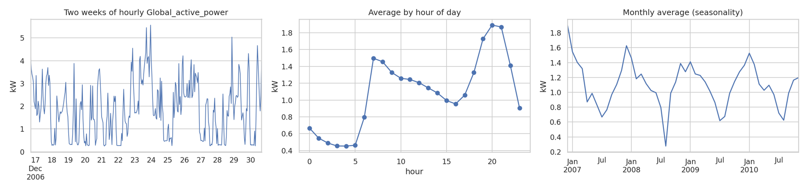
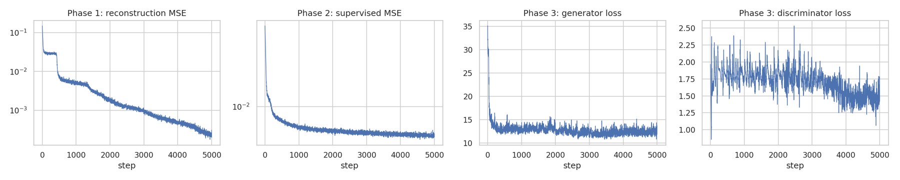
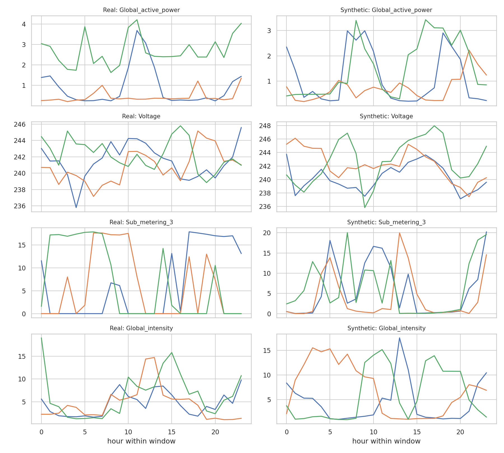
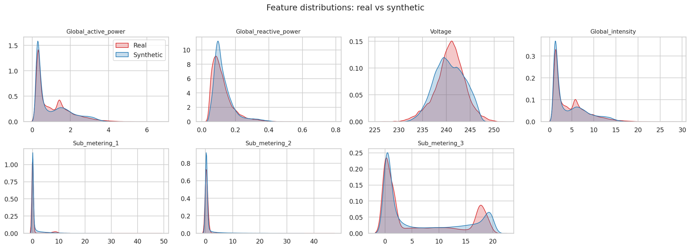
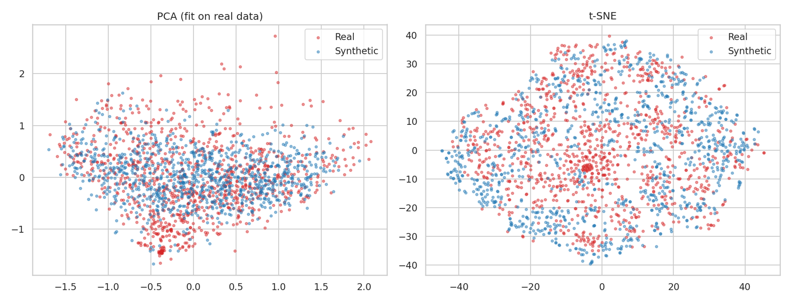
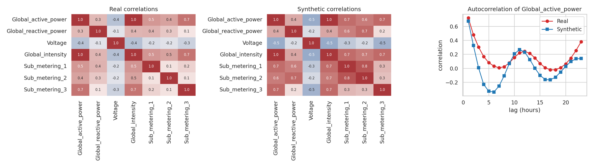
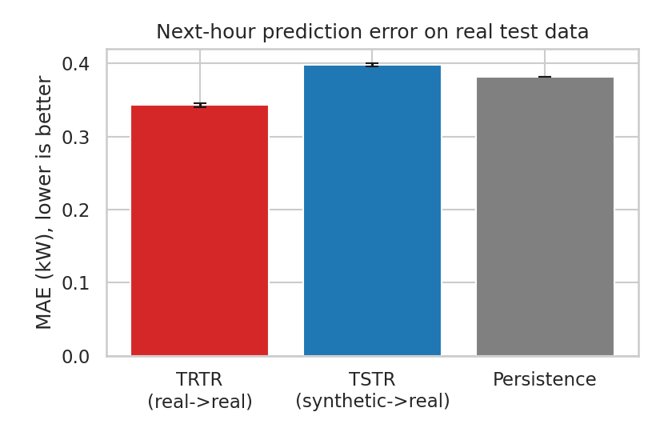

# Synthetic Time Series Generation with TimeGAN
### A case study on household electric power consumption

[](https://colab.research.google.com/github/YOUR_USERNAME/YOUR_REPO/blob/main/notebooks/Synthetic_Time_Series_Generation_with_TimeGAN_A_Case_Study_on_Household_Electric_Power_Consumption.ipynb)


Real smart-meter data is hard to share because it can reveal when people are home and what they do. This project trains **TimeGAN** (Yoon et al., NeurIPS 2019) on the UCI *Individual Household Electric Power Consumption* dataset to generate synthetic 24-hour load profiles. It then measures honestly how good they are, on fidelity, diversity, temporal structure and downstream usefulness.

**Full write-up:** [`report/Synthetic_Time_Series_Generation_with_TimeGAN__A_Case_Study_on_Household_Electric_Power_Consumption_report.pdf`](report/Synthetic_Time_Series_Generation_with_TimeGAN__A_Case_Study_on_Household_Electric_Power_Consumption_report.pdf) | **Code:** [`notebooks/Synthetic_Time_Series_Generation_with_TimeGAN_A_Case_Study_on_Household_Electric_Power_Consumption.ipynb`](notebooks/Synthetic_Time_Series_Generation_with_TimeGAN_A_Case_Study_on_Household_Electric_Power_Consumption.ipynb)

---

## Headline results

| Metric | What it checks | Result |
|---|---|---|
| PCA / t-SNE overlap | Diversity, mode collapse | Synthetic covers the real region, no isolated cluster |
| Correlation gap (mean abs. diff.) | Cross-feature structure | **0.147** |
| Autocorrelation gap (lags 1-23 h) | Temporal dynamics | **0.152** |
| Discriminative score `\|0.5 - acc\|` | Fidelity (lower is better) | **0.492 ± 0.002** (classifier accuracy 99.2%) |
| Forecast MAE, trained on real (TRTR) | Upper bound | **0.343 kW** |
| Forecast MAE, trained on synthetic (TSTR) | Utility of synthetic data | **0.398 kW** |
| Forecast MAE, persistence baseline | Naive reference | 0.381 kW |
| TSTR / TRTR ratio | Utility (1.00 = ideal) | **1.16** |

### What this means

- **Worked:** training was stable, per-feature distributions and the dominant correlations (power vs. intensity, voltage vs. load) were learned, and there was no mode collapse.
- **Did not work:** a simple LSTM tells real from synthetic windows 99.2% of the time, short-lag autocorrelation of active power is distorted, and the kitchen and laundry sub-meter correlation is over-estimated (about 0.8 synthetic vs. 0.1 real).
- **Utility:** a forecaster trained on synthetic data is about 16% worse than one trained on real data, and slightly worse than persistence. Synthetic data here is *somewhat useful, not a drop-in replacement*.
- **Caveat:** the real test windows come from a later period than the training data, so part of the discriminative score may be natural drift rather than generator error. The report discusses this and proposes a same-period hold-out as a follow-up.

I report these numbers as they came out, including the weak ones, and analyse why in the report.

---

## Pipeline

```
Raw per-minute data (2.07M rows, 7 variables)
   -> cleaning, hourly resampling, time-based interpolation
Hourly series (34,589 h)
   -> 80/20 chronological split, Min-Max scaling fitted on train only
24-hour sliding windows, shape (N, 24, 7)
   -> TimeGAN: embedding -> supervised -> joint training (5,000 iterations/phase)
10,000 synthetic windows -> inverse scaling
   -> evaluation
Visual / PCA / t-SNE | Correlation / ACF | Discriminative | Predictive (TSTR vs TRTR)
```

**Design decisions worth noting**
- **Chronological split**, not random, to avoid leakage between near-identical neighbouring hours.
- **Scaler fitted on training data only**, so no information leaks from the future.
- **TensorFlow 2 port** of the official TimeGAN (five stacked-GRU networks, three-phase training, same loss weights), written out so every loss term is explicit.
- **Evaluation repeated over 3 seeds** (mean ± std) for the discriminative and predictive scores.

| Setting | Value |
|---|---|
| Window length | 24 h |
| Features | 7 |
| Hidden dim / GRU layers | 24 / 3 (supervisor: 2) |
| Batch size / optimiser | 128 / Adam, lr 1e-3 |
| Iterations per phase | 5,000 (paper uses 10,000) |
| Training / test windows | 10,000 / 6,895 |

---

## Selected figures

**Daily cycle and seasonality in the real data**


**Training behaviour (stable, no collapse)**


**Real vs. synthetic 24-hour windows**


**Feature distributions**


**PCA and t-SNE: coverage of the real data**


**Correlation structure and autocorrelation (where the gap shows up)**


**Forecasting utility: TRTR vs. TSTR vs. persistence**


---

## Run it yourself

**Easiest: Google Colab**
1. Click the Colab badge above.
2. *Runtime -> Change runtime type -> GPU (T4)*.
3. *Runtime -> Run all*. The dataset is downloaded automatically through `kagglehub`. Training takes roughly 15-30 minutes on a free T4.

For a quick trial, lower `ITERATIONS` in Step 1 of the notebook.

**Locally**
```bash
git clone https://github.com/YOUR_USERNAME/YOUR_REPO.git
cd YOUR_REPO
python -m venv .venv && source .venv/bin/activate   # Windows: .venv\Scripts\activate
pip install -r requirements.txt
jupyter notebook "notebooks/Synthetic_Time_Series_Generation_with_TimeGAN_A_Case_Study_on_Household_Electric_Power_Consumption.ipynb"
```
If automatic download fails, get the dataset from the [UCI repository](https://archive.ics.uci.edu/dataset/235/individual+household+electric+power+consumption) or [Kaggle](https://www.kaggle.com/datasets/uciml/electric-power-consumption-data-set) and place `household_power_consumption.txt` next to the notebook.

Running the notebook writes figures, `results.json` and the synthetic windows to an `outputs/` folder (git-ignored).

---

## Repository structure

```
.
├── README.md
├── LICENSE
├── CITATION.cff
├── requirements.txt
├── notebooks/   end-to-end notebook (15 documented steps)
├── report/      PDF report
├── assets/      figures used in this README
└── docs/
    └── SKILLS.md   skills demonstrated and where
```

---

## Skills demonstrated

Deep learning and generative modelling (GANs, GRU/LSTM, TensorFlow 2 custom training loops), time-series preprocessing, rigorous evaluation of synthetic data, and honest scientific reporting. See [docs/SKILLS.md](docs/SKILLS.md) for the full breakdown with evidence.

---

## Limitations

1. Single household in one country, so findings may not transfer.
2. Hourly resampling removes minute-level appliance spikes.
3. 24-hour windows cannot capture weekly or seasonal patterns, and no calendar features were used.
4. 5,000 iterations per phase, one TimeGAN training run, default hyper-parameters, no tuning.
5. Test period follows the training period, so drift can inflate the discriminative score.
6. No baselines or ablations (RCGAN, C-RNN-GAN, TimeGAN without supervised loss).
7. No formal privacy guarantee (no differential privacy or membership-inference analysis).
8. The downstream task is a simple next-hour LSTM forecast.

## Future work

- Train longer (10k+ iterations per phase), tune hidden size, layers and gamma, and average over several training seeds.
- Add baselines and ablations (RCGAN, C-RNN-GAN, TimeGAN without the supervised loss).
- Compute the discriminative score against a same-period hold-out to separate drift from generator error.
- Treat sparse sub-metering channels separately or transform them before scaling.
- Condition on hour, weekday and season, and use longer windows to cover weekly structure.
- Evaluate privacy (membership inference, nearest-neighbour distance) and try differentially private training.
- Compare with diffusion and transformer-based time-series generators.

---

## References

1. Yoon, J., Jarrett, D., van der Schaar, M. *Time-series Generative Adversarial Networks.* NeurIPS 2019. [Official code](https://github.com/jsyoon0823/TimeGAN)
2. Esteban, C., Hyland, S. L., Rätsch, G. *Real-valued (Medical) Time Series Generation with Recurrent Conditional GANs.* arXiv:1706.02633, 2017.
3. Mogren, O. *C-RNN-GAN: Continuous Recurrent Neural Networks with Adversarial Training.* arXiv:1611.09904, 2016.
4. Hébrail, G., Bérard, A. *Individual Household Electric Power Consumption.* UCI Machine Learning Repository, 2012.
5. van der Maaten, L., Hinton, G. *Visualizing Data using t-SNE.* JMLR 9, 2008.

## Authors

**Gayathri P S** and **Asna Abbas**: MSc Data Analytics, Generative AI capstone.

## License

Released under the [MIT License](LICENSE). The dataset belongs to its original authors (UCI / Hébrail & Bérard) and is not redistributed here.
